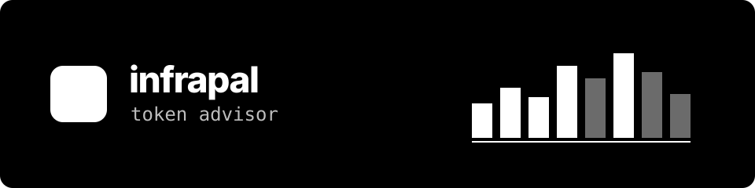
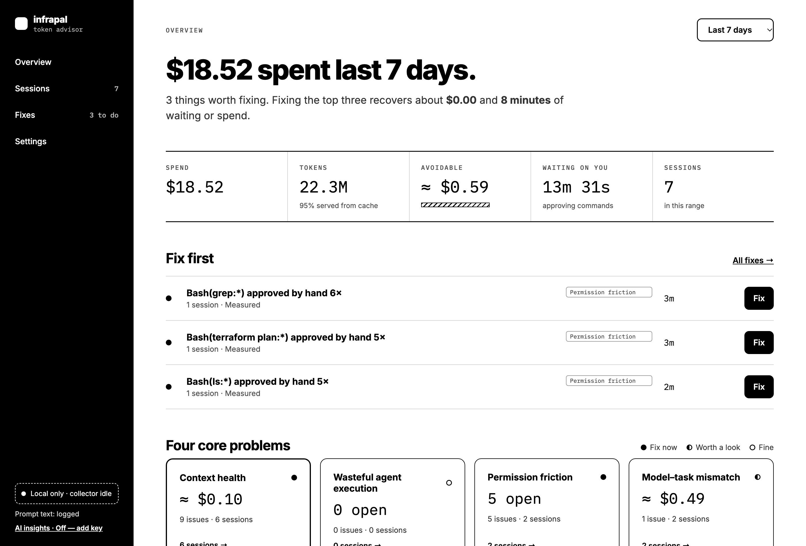
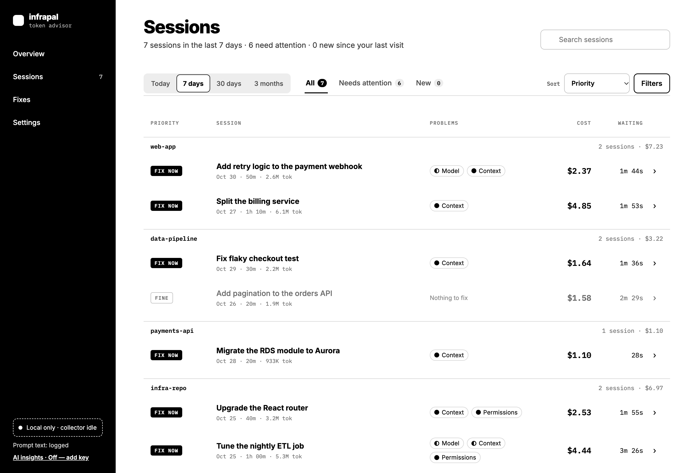
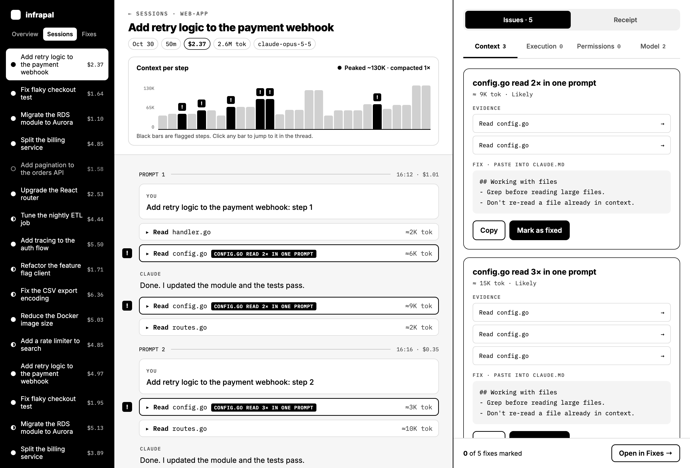
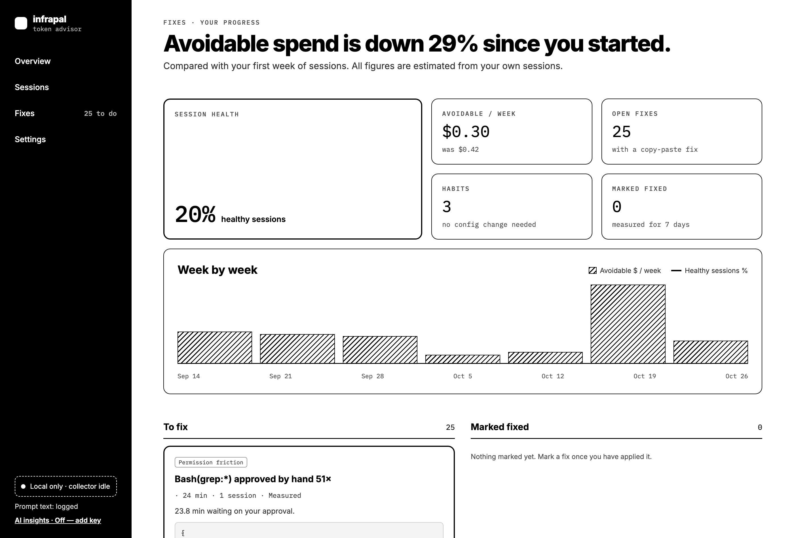
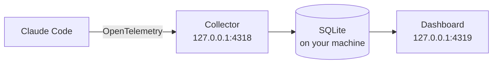

<div align="center">



# See where your Claude Code tokens go, and what to change

**A local dashboard that finds wasted tokens and hands you the fix.**<br>
Your data stays on your machine. No account, no cloud, no proxy.

[](https://github.com/infrapalhq/infrapal-token-advisor/actions/workflows/ci.yml)
[](https://securityscorecards.dev/viewer/?uri=github.com/infrapalhq/infrapal-token-advisor)
[](LICENSE)


**[Install](#install) · [What it finds](#what-it-finds) · [How it works](#how-it-works) · [Commands](#commands) · [Privacy](#privacy) · [FAQ](#faq) · [Docs](#documentation)**



<sub>All screenshots use made-up sample data.</sub>

</div>

## Why

Claude Code tells you what a session cost, but not why. token-advisor collects
the telemetry Claude Code already emits and shows you where it went: the file
read three times, the command you approve by hand every day, the short answer
from your most expensive model.

Then it tells you what to do: a settings change to paste in, or a habit to try.

## Get started

```sh
brew install --cask infrapalhq/tap/infrapal-token-advisor
token-advisor init
token-advisor ui
```

Restart any running Claude Code sessions, and use them as normal. Not on
Homebrew? See [other ways to install](#install).

## What you get

<table>
<tr>
<td width="50%" valign="top">
<b>Sessions</b><br>
Every session by project, with its cost, its problems and what to look at first.<br><br>

</td>
<td width="50%" valign="top">
<b>Step-by-step timeline</b><br>
See context grow step by step, with each issue marked where it happened.<br><br>

</td>
</tr>
<tr>
<td width="50%" valign="top">
<b>Fixes</b><br>
Paste a fix in, mark it done, and see week by week whether it helped.<br><br>

</td>
<td width="50%" valign="top">
<b>Numbers you can check</b><br>
Everything is labelled <b>Measured</b>, <b>Likely</b> or <b>Estimated</b>, and
<a href="docs/ACCURACY.md">the rules are documented</a>.<br><br>
<b>Optional AI Mode</b><br>
Add your own Anthropic API key for extra recommendations. It's off by default,
runs only when you press <b>Generate</b>, and never sends prompt text.
</td>
</tr>
</table>

## What it finds

| Issue | What it means | What you get |
| --- | --- | --- |
| **Re-read files** | The same lines read again in one prompt with nothing changed | Lines for your `CLAUDE.md` |
| **Repeated commands** | A command run again with nothing changed | A fix to paste in |
| **Repeated approvals** | A pattern you keep approving by hand | An allow rule, for read-only commands only |
| **Compactions** | A session filled its context | Habit advice |
| **Failing MCP servers** | A server whose calls keep failing | What to check |
| **Oversized model** | A short, simple answer from an Opus-class model | Habit advice |

## How it works



`init` turns on the telemetry Claude Code already supports. A small background
service receives it and writes it to SQLite, and the dashboard reads from there.
token-advisor is one Go binary with the dashboard built in. It isn't a proxy, so
it doesn't sit between Claude Code and the API.

## Install

You need macOS or Linux, and [Claude Code](https://code.claude.com/docs).

macOS, with Homebrew:

```sh
brew install --cask infrapalhq/tap/infrapal-token-advisor
```

Linux or macOS, without Homebrew. This installs to `~/.local/bin`, or to
`INSTALL_DIR` if you set it, and checks the download's checksum:

```sh
curl -fsSL https://raw.githubusercontent.com/infrapalhq/infrapal-token-advisor/main/scripts/install.sh | sh
```

Then start collecting. This patches `~/.claude/settings.json`, keeping a backup,
and installs a background service:

```sh
token-advisor init
```

Restart any running Claude Code sessions so they pick up the new settings, then
open the dashboard at http://127.0.0.1:4319, or run:

```sh
token-advisor ui
```

**Note:** `init` turns on Claude Code's prompt and tool-content logging, so the
database holds your prompts, responses, shell commands and file paths. Read
[what's stored](SECURITY.md#what-is-stored-locally) first.

## Commands

| Command | What it does |
| --- | --- |
| `token-advisor init` | Patch `settings.json`, create the database, install the service |
| `token-advisor status` | Show the service, database, retention and recent errors |
| `token-advisor doctor` | Work out why data isn't arriving, or why the service won't come back |
| `token-advisor ui` | Open the dashboard |
| `token-advisor logs` | Show the log (`-n 100`, `--errors`, `-f`) |
| `token-advisor start` | Run the collector and dashboard in the foreground |
| `token-advisor stop` | Stop the service until your next login |
| `token-advisor restart` | Restart the service, for example after an upgrade |
| `token-advisor export` | Export data (`--format jsonl\|csv --since 7d`) |
| `token-advisor purge` | Delete data (`--before 30d`, `--session <id>` or `--all`) |
| `token-advisor update` | Install the latest release (`--check` only reports it) |
| `token-advisor uninstall` | Restore `settings.json` and delete the service and data (`--keep-db` keeps the data) |
| `token-advisor version` | Print the version |

Run `token-advisor <command> -h` for a command's flags.

## Update

```sh
token-advisor update --check   # is there a newer release?
token-advisor update           # install it and restart the service
```

With Homebrew, use `brew upgrade --cask infrapal-token-advisor`, then
`token-advisor restart`. The database is backed up before any schema upgrade.

## Uninstall

```sh
token-advisor uninstall             # restores settings.json and deletes all data
token-advisor uninstall --keep-db   # the same, keeping ~/.infrapal-token-advisor
```

This doesn't remove the binary. Delete it, or run
`brew uninstall --cask infrapal-token-advisor`.

## Privacy

- The collector and dashboard only listen on `127.0.0.1`, and the dashboard
  refuses requests from web pages.
- Nothing leaves your machine unless you use AI Mode or run
  `token-advisor update`. There's no usage telemetry, automatic update check or
  crash reporting.
- Data older than 6 months is deleted automatically. You can change that, and
  `token-advisor purge` deletes data on demand.

[SECURITY.md](SECURITY.md) has the full list of what's stored and what's sent.

## FAQ

<details>
<summary><b>Does it send my prompts anywhere?</b></summary>
<br>
No. Telemetry goes from Claude Code to a service on your own machine. AI Mode is
the one exception to staying local, and it only sends aggregated figures and
labels, never prompt or response text. <a href="SECURITY.md#what-leaves-your-machine">See exactly what's sent</a>.
</details>

<details>
<summary><b>Will it slow Claude Code down?</b></summary>
<br>
It isn't in the path of your API calls. Claude Code exports telemetry alongside
its normal work, and the collector only receives it.
</details>

<details>
<summary><b>What happens if the collector isn't running?</b></summary>
<br>
Claude Code keeps working normally, but telemetry from that time isn't captured.
The service restarts on its own and comes back when you log in.
</details>

<details>
<summary><b>I'm on a subscription. Is the cost still useful?</b></summary>
<br>
Yes, as a measure of relative usage. The cost is what Claude Code calculates per
request, so it won't match a subscription bill. See
<a href="docs/ACCURACY.md">how accurate the numbers are</a>.
</details>

<details>
<summary><b>How much disk space does it use?</b></summary>
<br>
It depends on how much you use Claude Code. Data older than 6 months is deleted
automatically, and <code>token-advisor status</code> shows the database size.
</details>

<details>
<summary><b>Does it work on Windows?</b></summary>
<br>
Not at the moment. It supports macOS and Linux.
</details>

## Documentation

- [Operating guide](docs/OPERATIONS.md): the service, logs, settings, retention
  and troubleshooting
- [How accurate the numbers are](docs/ACCURACY.md)
- [Database schema and migrations](docs/SCHEMA.md)
- [Security](SECURITY.md)
- [Contributing](CONTRIBUTING.md)

## Build from source

You need Go, at the version in [`go.mod`](go.mod), and Node.js 24 for the
dashboard.

```sh
git clone https://github.com/infrapalhq/infrapal-token-advisor.git
cd infrapal-token-advisor
scripts/build-web.sh
go build ./cmd/token-advisor
./token-advisor init
```

The service keeps running that exact file, so keep it where it is, or copy it
somewhere stable before running `init`. See [CONTRIBUTING.md](CONTRIBUTING.md)
for tests and how to send a change.

## Contributing

Bug fixes, new insight checks and dashboard improvements are welcome. Start with
[CONTRIBUTING.md](CONTRIBUTING.md). For security problems, follow
[SECURITY.md](SECURITY.md) instead of opening an issue.

## License

[MIT](LICENSE)
