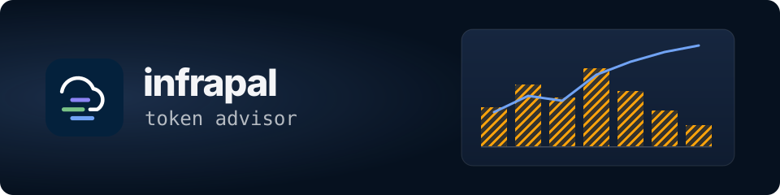
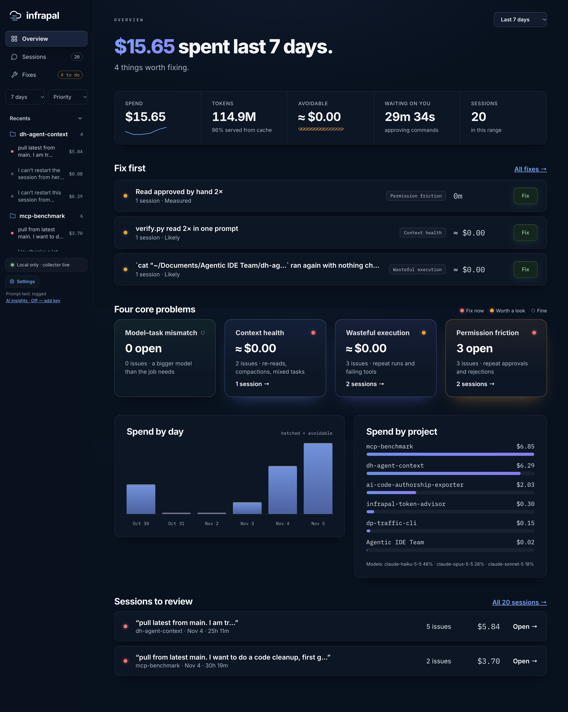
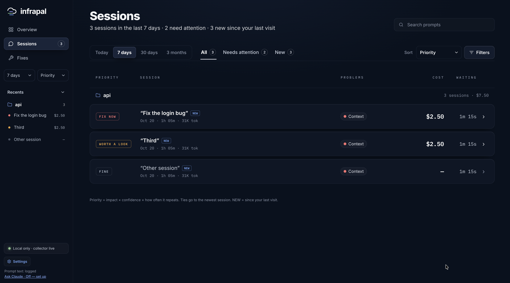
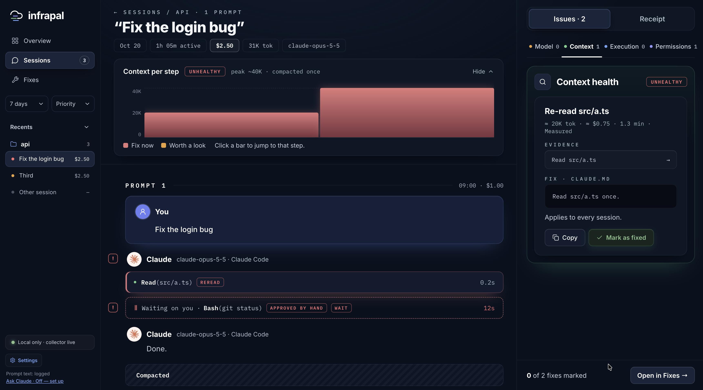
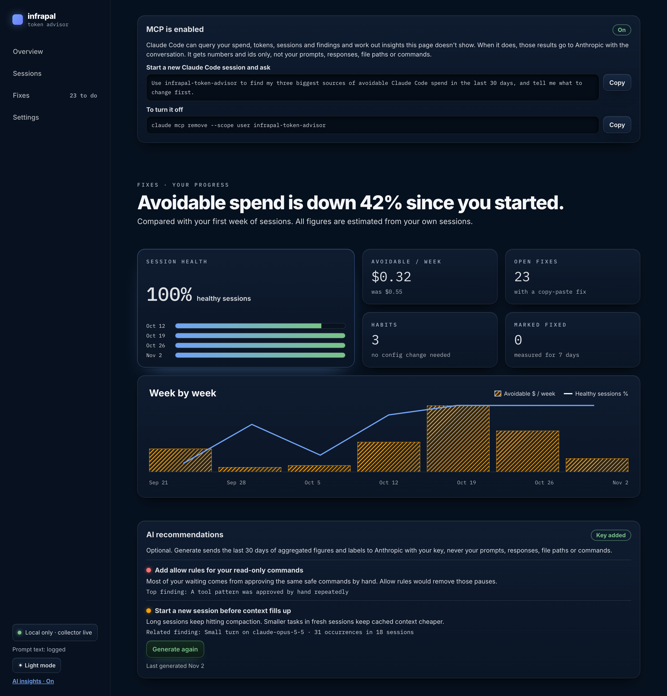
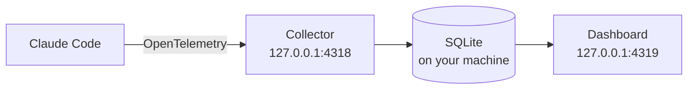

<div align="center">



# Less token waste. Better AI workflows.

**Get clearer insights into what is driving token usage across your Claude Code workflows, so you can spot inefficiencies and optimise with confidence.**<br>
Runs locally. No InfraPal account or hosted dashboard required.

[](https://github.com/infrapalhq/infrapal-token-advisor/actions/workflows/ci.yml)
[](https://codecov.io/gh/infrapalhq/infrapal-token-advisor)
[](https://securityscorecards.dev/viewer/?uri=github.com/infrapalhq/infrapal-token-advisor)
[](https://www.bestpractices.dev/projects/16290)
[](LICENSE)


**[Install](#install) · [What it finds](#what-it-finds) · [How it works](#how-it-works) · [Commands](#commands) · [Privacy](#privacy) · [FAQ](#faq) · [Docs](#documentation)**



<sub>All screenshots use made-up sample data.</sub>

</div>

## Why

Claude Code provides visibility into session costs, but understanding what drives those costs can take more investigation.

Token Advisor helps you explore where your tokens go — from repeated file reads and commands to model choices and growing context. It highlights potential inefficiencies and suggests practical improvements, whether that's a setting to review or a workflow habit to change.

## Get started

```sh
brew install --cask infrapalhq/tap/infrapal-token-advisor
token-advisor init
token-advisor ui
```

Restart any running Claude Code sessions, and use them as normal. Not on
Homebrew? See [other ways to install](#install).

## What you get

<table>
<tr>
<td width="50%" valign="top">
<b>Sessions</b><br>
Every session by project, with its cost, its problems and what to look at first.<br><br>

</td>
<td width="50%" valign="top">
<b>Step-by-step timeline</b><br>
See context grow step by step, with each issue marked where it happened.<br><br>

</td>
</tr>
<tr>
<td width="50%" valign="top">
<b>Fixes</b><br>
Review suggested improvements, track the changes you've made and monitor usage trends over time.<br><br>

</td>
<td width="50%" valign="top">
<b>Numbers you can check</b><br>
Know what's measured and what's estimated. Findings distinguish between Measured, Likely and Estimated values, with <a href="docs/ACCURACY.md">the methodology documented</a>.<br><br>
<b>Ask Claude</b><br>
Connect it to Claude Code and run <code>/infrapal-token-advisor:review</code> for
more suggestions. It uses your Claude Code plan, so there's no API key to add.
</td>
</tr>
</table>

## What it finds

| Issue | What it means | What you get |
| --- | --- | --- |
| **Re-read files** | The same lines read again in one prompt with nothing changed | Lines for your `CLAUDE.md` |
| **Repeated commands** | A command run again with nothing changed | A fix to paste in |
| **Repeated approvals** | A pattern you keep approving by hand | An allow rule, for read-only commands only |
| **Compactions** | A session filled its context | Habit advice |
| **Failing MCP servers** | A server whose calls keep failing | What to check |
| **Oversized model** | A short, simple answer from an Opus-class model | Habit advice |

## How it works



`init` turns on the telemetry Claude Code already supports. A small background
service receives it and writes it to SQLite, and the dashboard reads from there.
token-advisor is one Go binary with the dashboard built in. It isn't a proxy, so
it doesn't sit between Claude Code and the API.

## Install

You need macOS or Linux, and [Claude Code](https://code.claude.com/docs).

macOS, with Homebrew:

```sh
brew install --cask infrapalhq/tap/infrapal-token-advisor
```

Linux or macOS, without Homebrew. This installs to `~/.local/bin`, or to
`INSTALL_DIR` if you set it, and checks the download's checksum:

```sh
curl -fsSL https://raw.githubusercontent.com/infrapalhq/infrapal-token-advisor/main/scripts/install.sh | sh
```

Packagers can set `DESTDIR` to stage the binary under another directory, such as
`DESTDIR=./pkg INSTALL_DIR=/usr/local/bin`.

Then start collecting. This patches `~/.claude/settings.json`, keeping a backup,
and installs a background service:

```sh
token-advisor init
```

Restart any running Claude Code sessions so they pick up the new settings, then
open the dashboard at http://127.0.0.1:4319, or run:

```sh
token-advisor ui
```

**Note:** `init` turns on Claude Code's prompt and tool-content logging, so the
database holds your prompts, responses, shell commands and file paths. Read
[what's stored](SECURITY.md#what-is-stored-locally) first.

## Commands

| Command | What it does |
| --- | --- |
| `token-advisor init` | Patch `settings.json`, create the database, install the service |
| `token-advisor status` | Show the service, database, retention and recent errors |
| `token-advisor doctor` | Work out why data isn't arriving, or why the service won't come back |
| `token-advisor ui` | Open the dashboard |
| `token-advisor mcp` | Serve metrics to Claude Code over MCP (stdio); see [below](#ask-claude-about-your-data-mcp) |
| `token-advisor logs` | Show the log (`-n 100`, `--errors`, `-f`) |
| `token-advisor start` | Run the collector and dashboard in the foreground |
| `token-advisor stop` | Stop the service until your next login |
| `token-advisor restart` | Restart the service, for example after an upgrade |
| `token-advisor export` | Export data (`--format jsonl\|csv --since 7d`) |
| `token-advisor purge` | Delete data (`--before 30d`, `--session <id>` or `--all`) |
| `token-advisor update` | Install the latest release (`--check` only reports it) |
| `token-advisor uninstall` | Restore `settings.json` and delete the service and data (`--keep-db` keeps the data) |
| `token-advisor version` | Print the version |

Run `token-advisor <command> -h` for a command's flags.

## Update

```sh
token-advisor update --check   # is there a newer release?
token-advisor update           # install it and restart the service
```

With Homebrew, use `brew upgrade --cask infrapal-token-advisor`, then
`token-advisor restart`. The database is backed up before any schema upgrade.

## Uninstall

```sh
token-advisor uninstall             # restores settings.json and deletes all data
token-advisor uninstall --keep-db   # the same, keeping ~/.infrapal-token-advisor
```

This doesn't remove the binary. Delete it, or run
`brew uninstall --cask infrapal-token-advisor`.

## Ask Claude about your data (MCP)

`token-advisor mcp` serves the data to Claude Code over stdio. The
Fixes page shows the exact command for your install, or run:

```sh
claude mcp add --scope user infrapal-token-advisor -- "$(command -v token-advisor)" mcp
```

Then start a new Claude Code session and run one of its slash commands, or just
ask about your usage in your own words:

| Command | What Claude does |
| --- | --- |
| `/infrapal-token-advisor:review` | Reviews token usage and highlights the highest-priority opportunities for improvement. |
| `/infrapal-token-advisor:session <id>` | Explains why one session cost what it did |
| `/infrapal-token-advisor:compare` | Compares the last 7 days with the 7 days before |

Behind these are four read-only tools: `get_schema`, `run_sql` (limited to
`v_*` views), `get_findings` and `get_overview`. Claude runs them on your
Claude Code plan, so there's no separate API key.

Ask for an overview, and apps that support
[MCP Apps](https://modelcontextprotocol.io/extensions/apps/overview), such as
Claude, show it as an interactive view: spend, tokens, cache reuse, a daily
chart, spend by model and the top findings, with a range switch. Claude Code in
a terminal shows the same numbers as text.

Once you enable it, what these tools return goes to Anthropic with your
conversation. They return metrics and ids only. Prompts, responses, file paths,
commands, error text and user identity are withheld.

## Privacy

Token Advisor is designed to collect and analyse telemetry locally. Optional integrations and update commands may make external connections, so it's important to understand what information is shared when those features are enabled.

- The collector and dashboard only listen on `127.0.0.1`, and the dashboard
  refuses requests from web pages.
- Nothing leaves your machine unless you enable the MCP server or run
  `token-advisor update`. There's no usage telemetry, automatic update check or
  crash reporting.
- Data older than 6 months is deleted automatically. You can change that, and
  `token-advisor purge` deletes data on demand.

[SECURITY.md](SECURITY.md) has the full list of what's stored and what's sent.

## FAQ

<details>
<summary><b>Does it send my prompts anywhere?</b></summary>
<br>
No. Telemetry goes from Claude Code to a service on your own machine. The MCP
server is the one exception to staying local. It's off until you enable it, and
never sends prompt or response text. <a href="SECURITY.md#what-leaves-your-machine">See exactly what's sent</a>.
</details>

<details>
<summary><b>Will it slow Claude Code down?</b></summary>
<br>
It isn't in the path of your API calls. Claude Code exports telemetry alongside
its normal work, and the collector only receives it.
</details>

<details>
<summary><b>What happens if the collector isn't running?</b></summary>
<br>
Claude Code keeps working normally, but telemetry from that time isn't captured.
The service restarts on its own and comes back when you log in.
</details>

<details>
<summary><b>I'm on a subscription. Is the cost still useful?</b></summary>
<br>
Yes, as a measure of relative usage. The cost is what Claude Code calculates per
request, so it won't match a subscription bill. See
<a href="docs/ACCURACY.md">how accurate the numbers are</a>.
</details>

<details>
<summary><b>How much disk space does it use?</b></summary>
<br>
It depends on how much you use Claude Code. Data older than 6 months is deleted
automatically, and <code>token-advisor status</code> shows the database size.
</details>

<details>
<summary><b>Does it work on Windows?</b></summary>
<br>
Not at the moment. It supports macOS and Linux.
</details>

## Documentation

- [Operating guide](docs/OPERATIONS.md): the service, logs, settings, retention
  and troubleshooting
- [How accurate the numbers are](docs/ACCURACY.md)
- [Architecture](docs/ARCHITECTURE.md)
- [Database schema and migrations](docs/SCHEMA.md)
- [Adding an agent](docs/ADDING_AN_AGENT.md) and [adding a detector](docs/ADDING_A_DETECTOR.md)
- [Security](SECURITY.md) and the [security assurance case](docs/ASSURANCE.md)
- [Contributing](CONTRIBUTING.md) and [governance](GOVERNANCE.md)
- [Roadmap](ROADMAP.md) and [changelog](CHANGELOG.md)

## Build from source

You need Go, at the version in [`go.mod`](go.mod), and Node.js 24 for the
dashboard.

```sh
git clone https://github.com/infrapalhq/infrapal-token-advisor.git
cd infrapal-token-advisor
scripts/build-web.sh
go build ./cmd/token-advisor
./token-advisor init
```

The service keeps running that exact file, so keep it where it is, or copy it
somewhere stable before running `init`. See [CONTRIBUTING.md](CONTRIBUTING.md)
for tests and how to send a change.

## Contributing

Bug fixes, new insight checks and dashboard improvements are welcome. Start with
[CONTRIBUTING.md](CONTRIBUTING.md). For security problems, follow
[SECURITY.md](SECURITY.md) instead of opening an issue.

The MCP server is the exception, once you enable it: what its tools return goes
to Anthropic with your conversation. It returns metrics and ids only. Prompts,
responses, file paths, commands, error text and user identity are withheld.

## License

[MIT](LICENSE)
