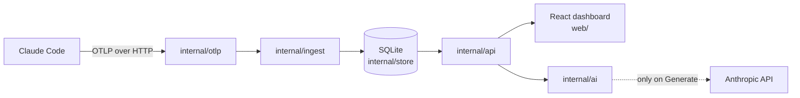

# Architecture

token-advisor is one Go binary with a React dashboard embedded in it. It receives
Claude Code's telemetry, stores it in SQLite, and works out what's worth changing.



## Principles

- **Local by default.** Nothing leaves the machine unless someone presses
  **Generate** in AI Mode or runs `token-advisor update`.
- **Rules first.** Every figure comes from telemetry and fixed rules. A model
  never produces a number, and the dashboard is complete without one.
- **Say how sure we are.** Every issue is labelled Measured, Likely or Estimated.
  See [ACCURACY.md](ACCURACY.md).
- **Every fix can be used.** A fix is something to paste in. An issue with no
  setting to change is a habit, not a fix.
- **Never lose telemetry quietly.** Claude Code doesn't buffer exports, so the
  collector must stay up, and nothing else may take it down.

## Packages

| Package | Job |
| --- | --- |
| `cmd/token-advisor` | Entry point |
| `internal/cli` | Commands: `init`, `start`, `doctor`, `purge` and the rest. Retention lives here too. |
| `internal/otlp` | Receives OTLP over HTTP on `127.0.0.1:4318` and decodes it |
| `internal/ingest` | Batches writes and projects events into typed tables |
| `internal/store` | Opens SQLite and runs migrations. See [SCHEMA.md](SCHEMA.md). |
| `internal/api` | HTTP API on `127.0.0.1:4319`, the detectors, and serving the dashboard |
| `internal/webui` | Embeds the built dashboard, or a placeholder without one |
| `internal/ai` | AI Mode: builds the aggregate-only context, calls the API, checks the answer |
| `internal/project` | Works out which project a session belongs to |
| `internal/claudesettings` | Reads, backs up and patches `~/.claude/settings.json` |
| `internal/service` | Installs the launchd or systemd user service |
| `internal/logging` | The rotating log and crash capture |
| `internal/update` | Finds and installs a release |
| `internal/config`, `internal/paths` | `config.json` and file locations |
| `web/` | The React dashboard |

## From telemetry to a fix

### Ingest

Every event goes into `events_raw` first, with its full body, so nothing is lost
if Claude Code adds an attribute we don't know about yet. The writers then project
it into typed tables such as `interactions`, `api_requests` and `tool_calls`.

`Enqueue` never blocks an HTTP handler. Logs, metrics and spans each have a
buffered writer that flushes in batches. If the database falls far behind, items
are dropped and logged. A failed batch is recorded in `ingest_errors`.

Telemetry has no working directory, so `internal/project` reads it from Claude
Code's transcript, or works it out from the files a session touched. The result is
saved on the session, because Claude Code deletes transcripts after 30 days.

### Database access

SQLite allows one writer, so `store.Open` pins each handle to one connection and
the Go pool serializes access. The collector and the dashboard each have their
own handle, so a slow dashboard query can't hold up ingest, and WAL mode lets them
read at the same time. Retention uses the collector's handle on purpose: ingest
waits behind a cleanup, where a second handle could time out and lose a batch.

### Detectors

Most figures come from SQL views, the `v_*` views, which keeps handlers thin.

Detectors in `internal/api/insight_detect.go` are pure functions over one
session's data. Each emits *occurrences*, which are grouped into items by kind and
subject. Items are ranked by:

```text
score = (usd + minutes × 0.10) × confidence × log2(1 + occurrences)
```

Confidence is 1.0 for Measured, 0.8 for Estimated and 0.7 for Likely. The 0.10 is
only a ranking weight, and is never shown as money.

Marking a fix stores a baseline in `fix_marks`, so the dashboard can compare before
and after over at least 7 days.

To add a detector, write the function, add it to the list that runs them, set a
confidence label, and document it in [ACCURACY.md](ACCURACY.md).

### AI Mode

`internal/ai` sends only aggregated figures and labels. It never sends prompts,
responses, tool content, file paths or commands, and a test fails if a sensitive
fixture string reaches the payload. Each recommendation must cite facts found in
what was sent, or it's dropped. Results are cached in `ai_recommendations`.

The model id is one constant, `HaikuModel` in `internal/ai/client.go`.

## Security boundaries

Both servers bind to `127.0.0.1`. The API holds prompts and has no login, so
`internal/api/guard.go` refuses requests whose `Host` isn't localhost, which stops
DNS rebinding, and refuses cross-origin writes. See [SECURITY.md](../SECURITY.md).

## Keeping it running

A dashboard failure is logged and never stops the collector. A panic in a
background goroutine is logged and ends the process, so the service manager
restarts it from a known state. A panic in one HTTP request answers 500 and nothing
else is affected.
