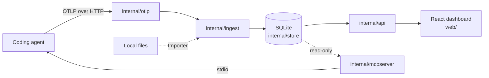

# Architecture

token-advisor is one Go binary with a React dashboard embedded in it. It receives
telemetry from coding agents, stores it in SQLite, and works out what's worth
changing. Claude Code is the agent supported today, and everything specific to it
sits behind an adapter.



## Principles

- **Local by default.** Nothing leaves the machine unless someone connects the
  MCP server to their agent or runs `token-advisor update`.
- **Rules first.** Every figure comes from telemetry and fixed rules. A model
  never produces a number, and the dashboard is complete without one.
- **Say how sure we are.** Every issue is labelled Measured, Likely or Estimated.
  See [ACCURACY.md](ACCURACY.md).
- **Every fix can be used.** A fix is something to paste in. An issue with no
  setting to change is a habit, not a fix.
- **Never lose telemetry quietly.** Claude Code doesn't buffer exports, so the
  collector must stay up, and nothing else may take it down.
- **Agents are adapters.** The core reads common events, tool categories and
  capabilities. Adding an agent shouldn't change it. See
  [ADDING_AN_AGENT.md](ADDING_AN_AGENT.md).

## Packages

| Package | Job |
| --- | --- |
| `cmd/token-advisor` | Entry point |
| `internal/cli` | Commands: `init`, `start`, `doctor`, `purge` and the rest. Retention lives here too. |
| `internal/otlp` | Receives OTLP over HTTP on `127.0.0.1:4318` and decodes it |
| `internal/localhttp` | Keeps web pages in your browser away from both local servers |
| `internal/agent` | The common model of a coding agent: events, tokens, tool categories and capabilities. Experimental until a second agent uses it |
| `internal/ingest` | Batches writes and projects events into typed tables |
| `internal/store` | Opens SQLite and runs migrations. See [SCHEMA.md](SCHEMA.md). |
| `internal/api` | HTTP API on `127.0.0.1:4319`, the detectors, and serving the dashboard |
| `internal/webui` | Embeds the built dashboard, or a placeholder without one |
| `internal/mcpserver` | `token-advisor mcp`: read-only tools and slash commands for Claude Code, over stdio |
| `internal/project` | Works out which project a session belongs to |
| `internal/agent/claudecode` | The Claude Code adapter: patches `~/.claude/settings.json` and checks the setup |
| `internal/agent/all` | The list of supported agents |
| `internal/agent/agenttest` | The contract every adapter must meet |
| `internal/agent/example` | A complete adapter to copy. It never ships |
| `internal/service` | Installs the launchd or systemd user service |
| `internal/logging` | The rotating log and crash capture |
| `internal/update` | Finds and installs a release |
| `internal/config`, `internal/paths` | `config.json` and file locations |
| `web/` | The React dashboard |

## From telemetry to a fix

### Ingest

Every event goes into `events_raw` first, with its full body, so nothing is lost
if an agent adds an attribute we don't know about yet. The writers then project
it into typed tables such as `interactions`, `api_requests` and `tool_calls`.

`Enqueue` never blocks an HTTP handler. Logs, metrics and spans each have a
buffered writer that flushes in batches. If the database falls far behind, items
are dropped and logged. A failed batch is recorded in `ingest_errors`.

An agent's adapter can bring data in two ways, and implements whichever fit:

- `LogSource` claims OTLP log records by their `service.name`, and maps each one
  to common events.
- `Importer` reads local files or databases in bounded batches. Each batch's events
  and cursor are saved in one transaction, so a crash can't lose or repeat one.

`internal/ingest/agent_events.go` writes common events to the same tables, and an
adapter never writes SQL. Records no adapter claims take Claude Code's own path,
because it fills far more columns than common events carry, and merges spans into
them. Common events use Claude Code's values for fields like `query_source`, because
the views and detectors still read those.

Every agent in `internal/agent/all` runs through the contract in
`internal/agent/agenttest`. `internal/agent/example` runs end to end in
`internal/api/example_agent_test.go`, from records to findings.

Telemetry has no working directory, so `internal/project` reads it from Claude
Code's transcript, or works it out from the files a session touched. The result is
saved on the session, because Claude Code deletes transcripts after 30 days.

### Database access

SQLite allows one writer, so `store.Open` pins each handle to one connection and
the Go pool serializes access. The collector and the dashboard each have their
own handle, so a slow dashboard query can't hold up ingest, and WAL mode lets them
read at the same time. Retention uses the collector's handle on purpose: ingest
waits behind a cleanup, where a second handle could time out and lose a batch.

### Detectors

Most figures come from SQL views, the `v_*` views, which keeps handlers thin.

Detectors in `internal/api/insight_detect.go` are pure functions over one
session's data. Each emits *occurrences*, which are grouped into items by kind and
subject. Items are ranked by:

```text
score = (usd + minutes × 0.10) × confidence × log2(1 + occurrences)
```

Confidence is 1.0 for Measured, 0.8 for Estimated and 0.7 for Likely. The 0.10 is
only a ranking weight, and is never shown as money.

Marking a fix stores a baseline in `fix_marks`, so the dashboard can compare before
and after over at least 7 days.

Checks read tool categories such as `agent.ToolRead`, not tool names, so they work
for any agent. A check also names the capabilities it needs, and only sees sessions
from agents that have them, so that "no problems" never means "couldn't look".

Fix text comes from the agent's `Advisor`. An agent without one still gets every
finding, with no fix to paste.

The dashboard reads `/api/agents` for what each agent can report. It shows `—`, never
`$0.00`, for a session with no cost, and lists the checks that were skipped. The
agent picker only appears with two or more agents.

To add one, see [ADDING_A_DETECTOR.md](ADDING_A_DETECTOR.md).

### MCP server

`token-advisor mcp` lets Claude Code ask about the data, on the user's own Claude
Code plan, so token-advisor never needs an API key. Claude Code starts it and
talks to it over stdio. It opens the database read-only, and offers:

- **Tools** (`tools.go`): `get_schema`, `run_sql`, `get_findings` and
  `get_overview`. `run_sql` only reads `v_*` views without content columns
  (`guard.go`), and `get_findings` and `get_overview` leave out project names,
  file paths and commands. What they return goes to Anthropic with the
  conversation, and a test fails if a sensitive fixture string comes back.
- **The overview view** (`apps.go`, `ui/overview.html`): `get_overview` links to
  the resource `ui://infrapal-token-advisor/overview.html`, an
  [MCP App](https://modelcontextprotocol.io/extensions/apps/overview). Hosts that
  support MCP Apps, such as Claude, draw it in a sandboxed frame: totals, spend
  by day and by model, and the top findings, with a range switch that calls
  `get_overview` again. Hosts that don't, such as Claude Code in a terminal,
  ignore the link and use the tool's text. The view is one HTML file with no
  external requests, so it works under the hosts' default content security
  policy.
- **Prompts** (`prompts.go`): `review`, `session` and `compare`, which Claude
  Code lists as `/infrapal-token-advisor:review` and so on. Each tells Claude
  which tools to use and to back every claim with a number. The dashboard's
  copy of the list is `web/src/ta/mcp.ts`.

## Security boundaries

Both servers bind to `127.0.0.1`, and neither has a login, so `internal/localhttp`
refuses requests whose `Host` isn't localhost, which stops DNS rebinding, and
refuses cross-origin writes. The collector also accepts only protobuf, which a web
page can't send cross-origin, and limits the size of what it reads. See
[ASSURANCE.md](ASSURANCE.md) for the full security argument, and
[SECURITY.md](../SECURITY.md) to report a problem.

## Keeping it running

A dashboard failure is logged and never stops the collector. A panic in a
background goroutine is logged and ends the process, so the service manager
restarts it from a known state. A panic in one HTTP request answers 500 and nothing
else is affected.
