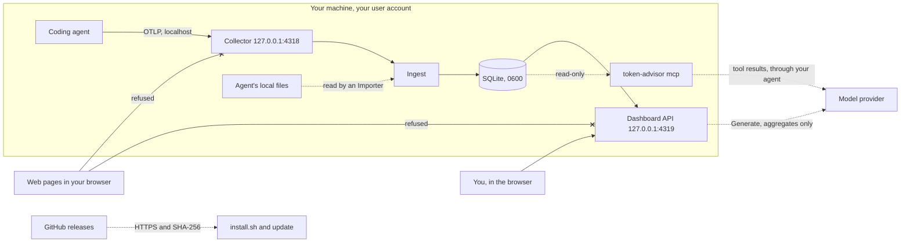

# Security assurance case

This is why we believe token-advisor meets its security requirements. It covers
what we protect, from whom, where the trust boundaries are, how the design
follows secure design principles, and how common weaknesses are countered. Each
claim names the code or test behind it, and the [last section](#known-gaps) lists
what isn't protected.

To report a problem, see [SECURITY.md](../SECURITY.md).

## What we protect

token-advisor stores what a coding agent tells it about your work. That can be
sensitive, so the requirements are:

1. **Confidentiality.** Prompts, responses, shell commands, file paths and
   project names never leave the machine, except in two cases you start
   yourself, described below.
2. **Integrity.** What the dashboard shows comes from your own agent, and a fix
   it suggests never widens what the agent may do without asking.
3. **Availability.** The collector stays up, because agents don't buffer
   telemetry. Anything lost while it's down is lost for good.
4. **Your settings.** Setup changes only what it needs to, keeps a backup, and
   can be undone.

| Asset | Where it lives |
| --- | --- |
| Telemetry, including prompts and commands | `~/.infrapal-token-advisor/token-advisor.db` |
| Your AI Mode API key, if you save one | `~/.infrapal-token-advisor/config.json` |
| Your agent's settings | Such as `~/.claude/settings.json`, with a backup made before any change |
| The binary you run | Wherever you installed it |

## Who we protect against

| Threat | In scope? |
| --- | --- |
| A web page open in your browser, which can send requests to `localhost` | Yes |
| A network attacker between you and GitHub, or you and a model provider | Yes |
| A tampered or compromised release, or dependency | Yes |
| Malformed or hostile telemetry, or a hostile local file read by an importer | Yes |
| Text from an AI model, which may be wrong or try to mislead | Yes |
| Another user account on the same machine | Partly. See [known gaps](#known-gaps) |
| Software running as you, or as root | No. It can already read your files and your agent's history |

## Trust boundaries

| Boundary | Crossed by | What we check |
| --- | --- | --- |
| Agent to collector | OTLP over HTTP | Loopback only, `Host` names this machine, no cross-origin request, `application/x-protobuf` only, size limits |
| Local files to ingest | An adapter's `Importer` | Bounded batches, damaged lines skipped, no panic on bad input |
| Browser to dashboard API | HTTP | Loopback only, `Host` names this machine, no cross-origin write |
| API to a model provider | HTTPS, only when you press **Generate** | Only aggregated figures and labels are sent, and answers are checked against them |
| MCP server to your agent | stdio | Read-only database, and only views with no content columns |
| GitHub to your machine | HTTPS | SHA-256 of every download against the release's checksums |

## Secure design principles

These follow Saltzer and Schroeder's principles.

- **Least privilege.** Nothing runs as root. The service is a per-user launchd
  agent or systemd user unit. The MCP server opens the database read-only, with
  `query_only` on (`store.OpenReadOnly`).
- **Fail-safe defaults.** Nothing leaves the machine by default. AI Mode needs a
  key and a button press, the MCP server needs you to register it, and raw
  request bodies need `init --raw-bodies`. A request the collector doesn't
  recognise is refused, and an MCP finding of a new kind sends only its numbers.
- **Complete mediation.** Every request to either server goes through
  `localhttp.Guard`, and every MCP query goes through `checkQuery`.
- **Economy of mechanism.** One static binary, built with `CGO_ENABLED=0`, with
  the dashboard embedded. Protections come from the Go standard library, such as
  `http.CrossOriginProtection`, rather than our own.
- **Open design.** Everything here is in the source, and nothing depends on an
  attacker not knowing it.
- **Separation of privilege.** The collector and the dashboard use separate
  database handles, so a slow dashboard query can't hold up ingest.
- **Least common mechanism.** Each agent's adapter changes only that agent's
  settings, with its own backup.
- **Psychological acceptability.** `doctor` explains what's wrong in plain words,
  and the dashboard says when a check was skipped or a cost is unknown, rather
  than showing a reassuring zero.

## Common weaknesses, and how they're countered

| Weakness | How it's countered | Evidence |
| --- | --- | --- |
| Cross-site request forgery (CWE-352) | `http.CrossOriginProtection` on both servers, and the collector accepts only `application/x-protobuf`, which a page can't send cross-origin without permission | `internal/localhttp`, `internal/otlp/guard_test.go` |
| DNS rebinding | Both servers compare `Host` to loopback names, without resolving it | `localhttp.IsLoopbackHost` and its tests |
| SQL injection (CWE-89) | Every query is parameterised. The only joined pieces are fixed strings in our code | `internal/api/insight_load.go`, `internal/ai/context.go` |
| SQL from an AI agent | `run_sql` allows one `SELECT` or `WITH`, on views with no content columns, through a read-only handle | `internal/mcpserver/guard.go` and its tests |
| Cross-site scripting (CWE-79) | React escapes all text, and nothing uses `dangerouslySetInnerHTML` | `web/src` |
| OS command injection (CWE-78) | No shell is ever run. Commands run with fixed arguments, and paths written into service files are escaped and quoted | `internal/service`, `FuzzSystemdExecPathRoundTrip` |
| Path traversal (CWE-22) | The dashboard serves only files embedded in the binary, through `fs.FS` | `internal/api/spa.go` |
| Resource exhaustion (CWE-400) | Body limits before and after decompression, server timeouts, bounded import batches and a bounded write buffer | `TestCollector_RefusesOversizedPayloads`, `internal/ingest` |
| Hostile input (CWE-20) | Protobuf and JSON decode into typed values. Attributes are type-checked, and unknown records are stored raw, not trusted | Fuzz tests in `internal/otlp` and `internal/api`, the adapter contract in `internal/agent/agenttest` |
| Sensitive data exposure (CWE-200) | AI Mode sends only aggregates, MCP results strip paths and commands, files are `0600` in a `0700` directory, and the API key is never returned by the API | `internal/ai/context_test.go`, `TestAIConfig_NeverReturnsTheKey`, `internal/paths` |
| Untrusted model output | A recommendation must cite facts that were sent, or it's dropped, and it's shown as plain text | `internal/ai/validate.go` |
| Over-broad permissions | An allow rule is only suggested for read-only commands, with no redirects, substitution or chained writes | `isSafePattern`, `FuzzIsSafePattern` |
| A crash taking the collector down | Panics are caught and logged. The service manager restarts it from a known state | `internal/logging` |
| Tampered downloads (CWE-494) | Every download is checked against the release's SHA-256 checksums, over HTTPS | `scripts/install.sh`, `internal/update` |
| Vulnerable dependencies (CWE-1395) | Dependabot, `govulncheck` and `npm audit` in CI, and Actions pinned to commit SHAs | `.github/dependabot.yml`, `.github/workflows` |

Static analysis (golangci-lint, CodeQL and oxlint) and the race detector run on
every pull request.

## Known gaps

We'd rather you knew these than discovered them.

- **Other accounts on the same machine.** Both servers accept any local
  connection, and localhost has no way to tell which user sent it. On a shared
  machine, another user could read your dashboard while the collector runs. The
  database file itself is private to you.
- **Data at rest isn't encrypted.** The database and your API key are protected
  by file permissions only. Full-disk encryption covers this.
- **Prompt logging is on by default** for Claude Code, so the dashboard can show
  your prompts. It stays on your machine, and data is deleted after 6 months by
  default.
- **Release signing isn't in place yet.** Downloads are checked against
  checksums, but the checksums aren't signed. It's planned before the first
  release.
- **The dashboard sends no security headers yet,** such as a content security
  policy. The other protections don't depend on them.
- **The adapter interface is new.** An adapter that maps data carelessly could
  mislead the dashboard. The contract tests limit this, but can't rule it out.
